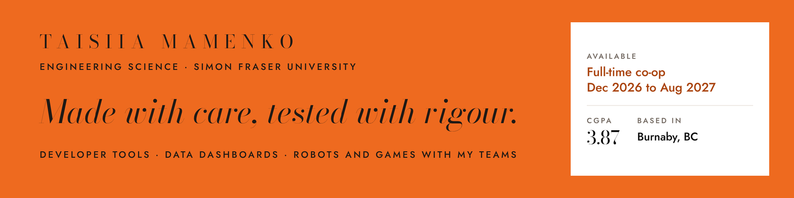
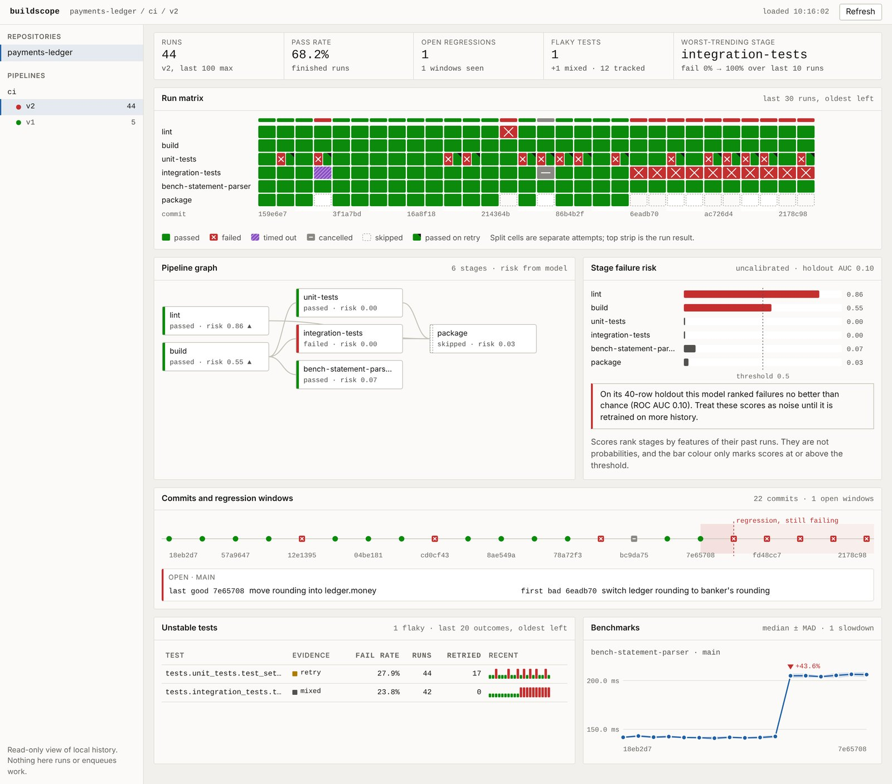
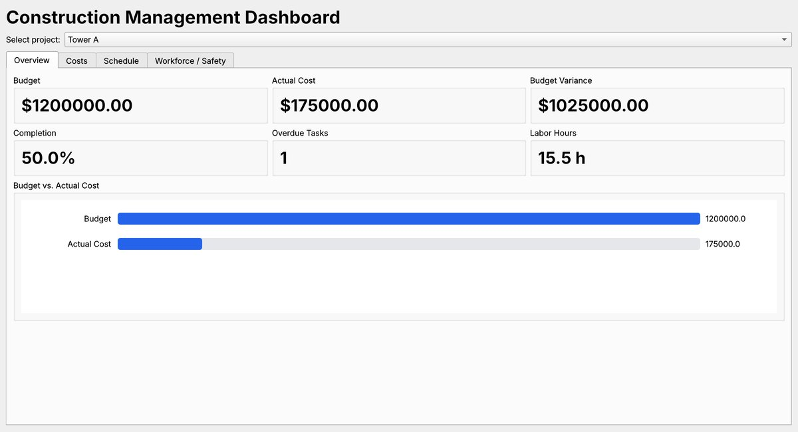

  <a href="https://liltaya.github.io"><b>Portfolio</b></a> &nbsp;·&nbsp;
  <a href="https://www.linkedin.com/in/taya-mamenko-2978b4323"><b>LinkedIn</b></a> &nbsp;·&nbsp;
  <a href="mailto:tma133@sfu.ca"><b>tma133@sfu.ca</b></a> &nbsp;·&nbsp;
  <a href="https://liltaya.github.io/Taisiia_Mamenko_Resume.pdf"><b>Résumé</b></a>

I'm Taya, an Engineering Science student at Simon Fraser University. I build developer tools and data dashboards, and with my SFU teams, robots and games. Every solo project here runs its tests in CI on every change.

**Open to:** a full-time software or engineering co-op, **December 2026 to August 2027**.

## Featured work

**[BuildScope](https://github.com/liltaya/buildscope-ai)** &nbsp;·&nbsp; Python, FastAPI, SQLAlchemy, SQLite, JavaScript, C++20 &nbsp;·&nbsp; *v0.1.0, November 2026* 
A local CI runner that keeps every attempt, test result and benchmark sample, then tells you which commit broke the build, which tests are flaky rather than broken, and which stage got slower. Inside: DAG validation, a durable job queue with leases and crash recovery, flaky-test classification, benchmark slowdown detection and a logistic-regression failure model. 
`706 test cases passing` `24 merged pull requests` `CI on Ubuntu and macOS`

<table>
  <tr>
    <td width="50%" valign="top">
       
      <b><a href="https://github.com/liltaya/Construction-dashboard">Construction Analytics Dashboard</a></b> 
      C++20 · Qt6 · SQLite · CMake 
      Four views of budget, schedule, workforce and safety, with CSV imports validated row by row and saved all or nothing. 
      <code>25/25 GoogleTest</code> <code>ASan + UBSan in CI</code>
    </td>
    <td width="50%" valign="top">
       
      <b><a href="https://liltaya.github.io/#robot">Stair-Climbing Robot</a></b> 
      ENSC 100 team · C++ · Raspberry Pi 
      A robot built to climb stairs, with its motors driven by a Raspberry Pi. I helped assemble it and wrote the C++ code for the Pi.
    </td>
  </tr>
</table>

**[Operational Data Platform & Log Analyzer](https://github.com/liltaya/Flask-service)** &nbsp;·&nbsp; Python, Flask, PostgreSQL, Docker, Nginx, Prometheus, Grafana 
A Flask and PostgreSQL API with health checks and metrics, deployed behind Nginx with systemd or in Docker Compose, plus a command-line analyzer that flags attacks like SQL injection and path traversal in server logs. 
`1,000,000 log lines in 16.2 s` `38 tests` `4 CI jobs`

**[Virus.exe](https://github.com/liltaya/virus-exe)** &nbsp;·&nbsp; C++ &nbsp;·&nbsp; *ENSC 251 team of four, in progress* 
A two-player strategy card game where each player defends a computer's CPU, memory, network and storage with an ordinary 52-card deck. I proposed the concept and rules, designed the class model, and wrote the Game and GameUI classes.

The software above was built, run and tested on 13 November 2026, and the screenshots come from those runs.

## Toolkit

## How I work

- **Tested before it ships.** Tests run in CI on every change, from 25 GoogleTest cases to 706 pytest cases.
- **Checked before it is saved.** Imports are validated row by row, and bad data is rejected with a reason before it reaches a database.
- **Written down.** Architecture notes, data models and release guides live next to the code.

Burnaby, BC · Authorized to work in Canada · <a href="https://liltaya.github.io">liltaya.github.io</a>
